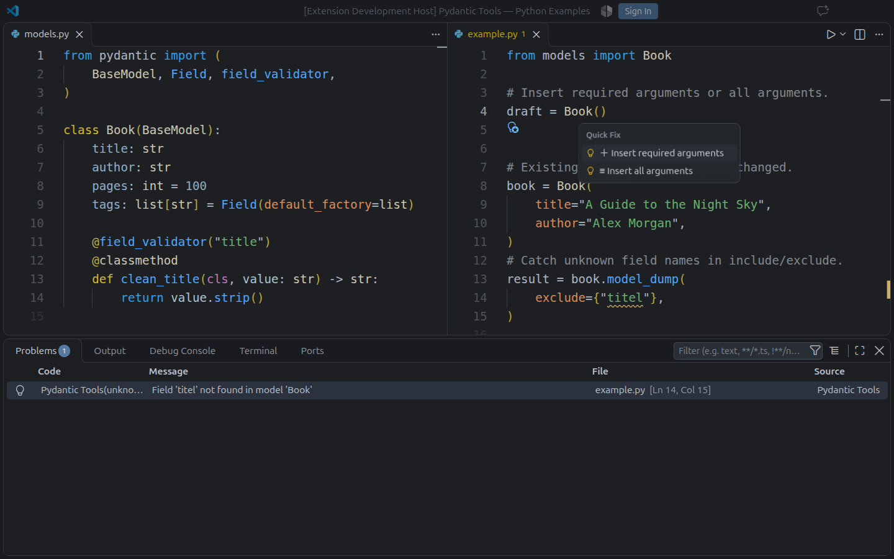

# Pydantic Tools

PyCharm-inspired Pydantic actions and field-name assistance for Visual Studio Code.

This is a VS Code adaptation of selected behavior from [Pydantic PyCharm Plugin](https://github.com/Toximiner/pydantic-pycharm-plugin), originally created by Koudai Aono. The Kotlin/JetBrains PSI implementation cannot run in VS Code; this extension uses VS Code providers and Pylance instead. It is an independent extension, not an official Pydantic or JetBrains product.

## Preview



The screenshot uses only the fictional examples in [examples](examples).

## Features

- **＋ Insert required arguments** and **≡ Insert all arguments** in Quick Fix, the editor context menu, and the Command Palette.
- Preserve existing arguments and comments. Insert missing keyword arguments as a multiline snippet; press **Tab** to move between values. One undo restores the call.
- Required values are left empty, matching the PyCharm action. Available literal defaults are inserted for optional parameters. Built-in collection factories become empty collections; other unknown defaults are left for you to fill in.
- Use Pylance's constructor signature for inheritance, aliases, generics, and Pydantic dataclasses.
- Complete field names inside `include`/`exclude` and `@field_validator`, `@validator`, and `@field_serializer`.
- Warn when a literal field name is missing from the model.
- Go to the field declaration from a field-name string with **Go to Definition**.

```python
from pydantic import BaseModel

class Book(BaseModel):
    title: str
    pages: int = 100

book = Book()  # Quick Fix: Insert required arguments / Insert all arguments
book.model_dump(exclude={"titel"})  # Field 'titel' not found in model 'Book'
```

Field checks and completion use **field names**, not constructor aliases. Inherited fields are included; private attributes and `ClassVar` are excluded. Computed fields are included for serialization, but not validator-field completion. `check_fields=False` and validator `'*'` are respected.

Supported serialization calls: `model_dump`, `model_dump_json`, `dict`, and `json`. Calls on instances, direct constructor results, and chains such as `Book.model_validate(data).model_dump(...)` are supported.

## Installation

Install [Pydantic Tools from Visual Studio Marketplace](https://marketplace.visualstudio.com/items?itemName=Toximiner.pydantic-tools), or run:

```sh
code --install-extension Toximiner.pydantic-tools
```

VSIX packages are also available from [GitHub Releases](https://github.com/Toximiner/pydantic-tools/releases).

## Requirements and usage

Install Microsoft's **Python** and **Pylance** extensions, select the project's Python interpreter, and ensure Pydantic is installed in that environment. Wait for Pylance to index the project.

Place the cursor on a model constructor and open **Quick Fix** (the lightbulb). The same actions are available by right-clicking in a Python editor, or through **Pydantic: ＋ Insert Required Arguments** / **Pydantic: ≡ Insert All Arguments** in the Command Palette.

For field-name completion, place the cursor between quotes in `exclude={""}` or `@field_validator("")` and invoke completion. Unknown names appear in the Problems panel and as editor underlines.

The extension does not import or execute your Python modules, run default factories, or send source code to a remote service. Type information comes from Pylance.

## Scope of the PyCharm adaptation

| PyCharm capability | VS Code implementation |
| --- | --- |
| Insert missing required/all constructor arguments | Implemented here using Pylance signature help |
| Validator/serializer field completion and unknown-field inspection | Implemented here for literal field names |
| Unknown fields in serialization include/exclude | Implemented here for top-level literal set entries and dictionary keys |
| Navigate from field-name strings to declarations | Implemented here |
| Constructor completion, model type analysis, ConfigDict typing | Provided by Pylance; not duplicated |
| Rename a model field and update field-name strings everywhere | Not yet implemented |
| Regex-language injection in Field/constr | Not yet implemented |
| PyCharm's permissive/parsable type-checking rules | Not transferred; VS Code uses Pylance's rules |

## Current limits

This is an early release, tested with Python 3.12, Pydantic 2.12.5/2.14.4, and Pylance 2026.4.1.

- Constructor support depends on the signature Pylance exposes. Dynamic `create_model`, complex validation aliases, and some `Annotated` defaults may not expose enough static information.
- `*args`, `**kwargs`, ambiguous union types, and overloaded constructors are not guessed.
- `include`/`exclude` checks cover **top-level literal keys**, not nested exclusion dictionaries or variables containing field names. `RootModel` serialization checks are skipped because its output is the wrapped value rather than model fields.
- Escaped or dynamically computed strings are not checked. Complete quoted strings are needed for field-name completion.
- Fields must be declared as normal indented class attributes. Dynamic class mutation is outside this release's scope.
- Actions insert editable empty values, so the call remains incomplete until you fill them in.
- Go to Definition from field strings is supported; automatic rename inside those strings is not.

## Settings

- `pydanticTools.enabled`: enable or disable the extension's assistance.
- `pydanticTools.unknownFieldDiagnostics`: enable or disable unknown-field warnings.

## Development

No runtime npm dependencies are required. CI uses Node.js 24:

```sh
npm ci
npm run check
npm test
npm run package
```

The integration suite in `test/integration.cjs` runs in a separate VS Code Extension Development Host with the real Python and Pylance extensions. It uses only the fictional library examples in `test/fixtures`. Set `PYDANTIC_TOOLS_TEST_ROOT` to an isolated directory containing `test-workspace` (a copy of those fixtures) and `venv/bin/python` with Pydantic installed. It writes its results to that directory and never opens the user's project.

## Releases

Push a version tag matching `package.json` (for example, `v0.1.1`) to run tests and create a GitHub Release with the VSIX and SHA-256 checksums.

Run **Publish to Visual Studio Marketplace** against the same tag to publish through the publisher's Trusted Publishing policy. No long-lived publishing token is stored in this repository.

## Credits

The action names, empty-value insertion workflow, and feature selection follow [Pydantic PyCharm Plugin](https://github.com/koxudaxi/pydantic-pycharm-plugin), licensed under MIT by Koudai Aono. The reference fork inspected for this adaptation was commit `b994af127ab1a68dd5bc3076a49bfab902f580d0`.

See `THIRD_PARTY_NOTICES.md` for attribution and the upstream license.
